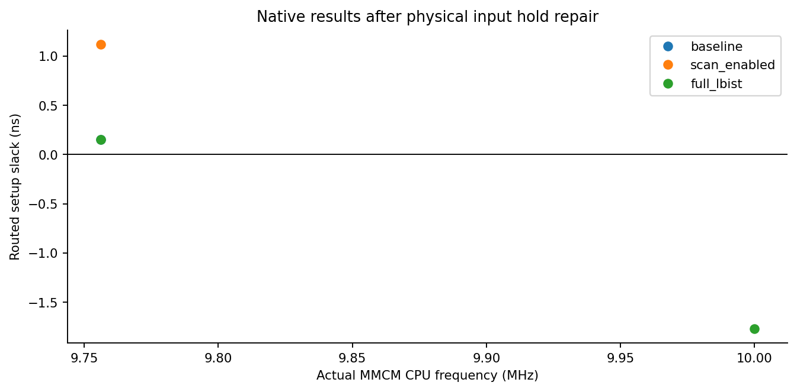
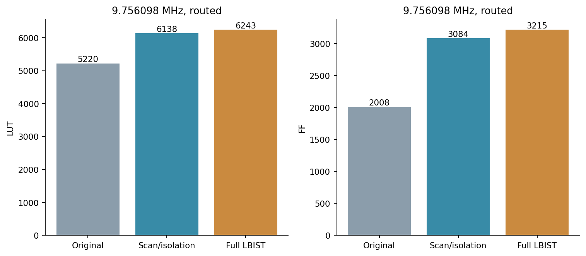
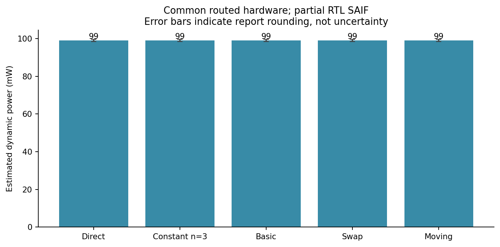
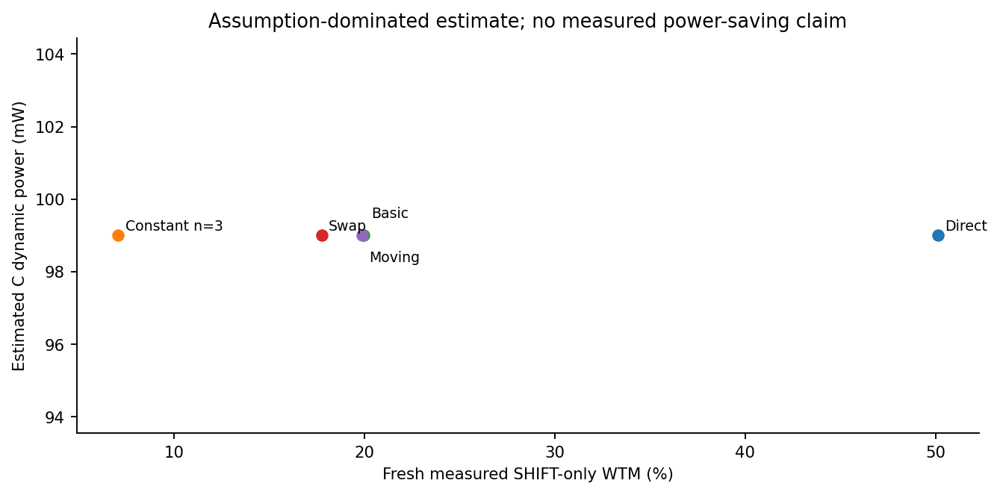

# Final FPGA timing revision

**PASS: constrained OOC setup/hold/pulse and unconstrained-path checks.** 9.756097561 MHz is the highest tested common timing-clean OOC point. This is an out-of-context processor result under the documented virtual-interface contract, not a board-qualified maximum or an exhaustive search over all MMCM ratios/place-and-route seeds. The original 50 MHz results remain in the parent directories; their report and clock sources are frozen in `original_50mhz_sources/`.

## What failed and what changed

The original 50 MHz full-LBIST design had WNS−76.315 ns, TNS−7796.277 ns, WHS−2.726 ns and 1,278 setup-failing endpoints. Its worst data path was 96.283 ns, crossing long original processor combinational logic into HI storage. At 50 MHz, cross-phase c1→c0 and c0→c1 paths had only 5 ns available and also failed. The worst original hold path was irq[0]→MM_int_req_reg[0]/D: using c0 as the external I/O reference included negative MMCM compensation source latency in the external launch time.

The board reference stays 100 MHz. The clock wrapper now supports integer VCO multipliers 6–12 with DIVCLK=1, and even common output dividers 4–84. clk remains 50% duty; phi1 remains 270°/25% duty, phi2 remains 0°/25% duty and phi3 remains 90°/25% duty. Default generics still reproduce the historical 50 MHz design; the revision explicitly sets M=8, D=82, VCO=800 MHz, CPU period=102.5 ns.

An important rejected experiment: divide 100 at a 1 GHz VCO and divide 120 at a 600 MHz VCO do not preserve legal 25% duty counters. UNISIM warns about unreachable duty cycles/phase delay, even though ideal STA clock reports list the requested waveforms. A 75%-low count must fit the output counter and the 270° phase delay must fit its 6-bit count. Even dividers through 84 satisfy these bounds. Thus 5 MHz cannot be generated by this unchanged direct-MMCM, quarter-duty architecture at the minimum 600 MHz VCO. These attempted results are retained but marked `MMCMQuarterDutyLegal=False`, and never count as timing-clean hardware. The legal 800 MHz VCO configurations avoid clipping and pass the actual UNISIM phase test.

The external OOC contract uses a virtual CPU clock at the generated CPU period, with 0.5 ns minimum/2 ns maximum input and output delays. It models an external synchronous provider at the CPU phase origin without misusing MMCM compensation latency. All actual processor clocks remain related and timed. No asynchronous groups or multicycle exceptions are used. The only false path is asynchronous reset-button assertion to CLR/PRE/RST; release uses the existing two-clock synchronizer. Automatic device/MMCM jitter and phase uncertainty replace the blanket 0.1 ns override, which caused Timing 38-195 under-budget warnings on virtual-clock paths. Full applied XDC and native clocks reports are included per implementation.

Remaining external-input hold violations could not be detoured on unlocated OOC port segments. The final ECO inserts LUT1 identity delays only on actual failing input paths. Each original leaf sink is disconnected from its own hierarchy-local net and reconnected with an explicit hierarchical connection. Connectivity is checked for every sink, and LUT INIT=2 implements O=I0. No flip-flop, processor instruction, scan chain, capture schedule or LBIST architecture is changed. Necessary physical delay cells are counted in routed utilization; DONT_TOUCH applies only to these hold delays. Failed early buffer-connection attempts left orphan cells, which are explicitly removed before final analysis and are not counted as production overhead. The final netlists and timing reports, not a list of requested ECO cells, establish whether repair succeeded.

## Frequency sweep

| Variant | Configuration | FrequencyMHz | MMCMQuarterDutyLegal | WNS | WHS | SetupFails | HoldFails | TimingClean |
| --- | --- | --- | --- | --- | --- | --- | --- | --- |
| initial | full_lbist | 10 | False | -0.421 | -0.012 | 4 | 2 | False |
| initial | full_lbist | 20 | True | -47.041 | -0.052 | 49 | 2 | False |
| initial | full_lbist | 10.416667 | False | -2.387 | -0.196 | 33 | 23 | False |
| initial | full_lbist | 5 | False | 35.942 | -0.123 | 0 | 5 | False |
| initial | full_lbist | 10 | True | -2.186 | -0.223 | 31 | 6 | False |
| initial | baseline | 9.756098 | True | 0.054 | -0.031 | 0 | 1 | False |
| initial | full_lbist | 9.756098 | True | 0.494 | -0.228 | 0 | 10 | False |
| initial | scan_enabled | 9.756098 | True | 1.038 | -0.185 | 0 | 15 | False |
| initial | full_lbist | 9.52381 | True | 0.79 | -0.228 | 0 | 6 | False |
| physical_repair | full_lbist | 10 | True | -1.768 | 0.038 | 26 | 0 | False |
| physical_repair | baseline | 9.756098 | True | 0.154 | 0.069 | 0 | 0 | True |
| physical_repair | full_lbist | 9.756098 | True | 0.155 | 0.007 | 0 | 0 | True |
| physical_repair | scan_enabled | 9.756098 | True | 1.12 | 0.001 | 0 | 0 | True |



`frequency_sweep.csv` retains successful routing separately from timing closure. `cross_phase_timing.csv` records setup and hold for each clock pair. A point is accepted only with WNS≥0, TNS=0, WHS≥0, THS=0, no setup/hold/pulse failures, and no unintended unconstrained endpoints/ports. The intentionally false-pathed asynchronous reset is the only missing-input-delay exception. Small positive margins are reported as measured; no additional board margin or global maximum-frequency proof is inferred.

| Configuration | From | To | SetupWNS | HoldWHS | SetupFails | HoldFails |
| --- | --- | --- | --- | --- | --- | --- |
| baseline | c0 | c0 | 0.154 | 0.161 | 0 | 0 |
| baseline | c1 | c0 | 12.719 | 77.282 | 0 | 0 |
| baseline | c0 | c1 | 72.736 | 25.605 | 0 | 0 |
| full_lbist | c0 | c0 | 0.155 | 0.056 | 0 | 0 |
| full_lbist | c1 | c0 | 14.789 | 0.482 | 0 | 0 |
| full_lbist | c0 | c1 | 13.402 | 25.49 | 0 | 0 |
| scan_enabled | c0 | c0 | 1.12 | 0.053 | 0 | 0 |
| scan_enabled | c1 | c0 | 14.623 | 0.303 | 0 | 0 |
| scan_enabled | c0 | c1 | 13.151 | 25.481 | 0 | 0 |

## Matched final implementations

| Configuration | LUT | FF | LUTRAM | BRAM36Equivalent | DSP | CARRY4 | Latches | BUFG | MMCM |
| --- | --- | --- | --- | --- | --- | --- | --- | --- | --- |
| baseline | 5220 | 2008 | 0 | 1 | 7 | 715 | 0 | 3 | 1 |
| scan_enabled | 6138 | 3084 | 0 | 0 | 7 | 715 | 0 | 4 | 1 |
| full_lbist | 6243 | 3215 | 0 | 0 | 7 | 725 | 0 | 4 | 1 |

| Configuration | FrequencyMHz | WNS | TNS | WHS | THS | SetupFails | HoldFails | TimingClean |
| --- | --- | --- | --- | --- | --- | --- | --- | --- |
| baseline | 9.756098 | 0.154 | 0 | 0.069 | 0 | 0 | 0 | True |
| scan_enabled | 9.756098 | 1.12 | 0 | 0.001 | 0 | 0 | 0 | True |
| full_lbist | 9.756098 | 0.155 | 0 | 0.007 | 0 | 0 | 0 | True |

| Configuration | LUTUtilizationPercent | FFUtilizationPercent | FirstSetupPathNS | PhysicalInputHoldBuffers |
| --- | --- | --- | --- | --- |
| baseline | 25.1 | 4.83 | 102.271 | 0 |
| scan_enabled | 29.51 | 7.41 | 101.041 | 15 |
| full_lbist | 30.01 | 7.73 | 102.017 | 4 |

| Comparison | LUTDelta | LUTPercent | FFDelta | FFPercent |
| --- | --- | --- | --- | --- |
| Scan/isolation vs original | 918 | 17.5862 | 1076 | 53.5857 |
| Full LBIST vs original | 1023 | 19.5977 | 1207 | 60.1096 |
| LBIST addition vs scan | 105 | 1.7107 | 131 | 4.2477 |



All three final implementations use the same part, clock ratio, related phases, I/O contract and automatic uncertainty policy. All are synthesized from actual original/scan/full-LBIST processor sources with runtime instruction/data/test interfaces. Fault muxes and debug buses remain excluded. Physical hold repair uses the same demand-driven identity-buffer procedure. Post-implementation LUT/FF counts include all required repair cells; their per-port connectivity evidence is in `closed/m8_d82/<configuration>/hold_buffer_connectivity.csv`. Historical BRAM-to-FF inference differences remain part of the existing helper implementation, not an ideal scan-mux cost. Original 50 MHz utilization is never substituted in these new-frequency tables.

Vivado still warns that unlocated OOC ports lack HD.PARTPIN_LOCS and the source lacks a board clock pin location. External port segments are not fully routed, so their real timing is not established by this experiment. Internal related-clock paths are analyzed; input/output timing depends on the stated virtual interface and partial-route model. These warnings prevent a board-level timing-closure or guaranteed operating-frequency claim. No package-pin feasibility or bitstream is claimed.

## Functional verification and activity

| Case | Group | ClockMHz | CompletionPS | Result |
| --- | --- | --- | --- | --- |
| actual_mmcm | Clock | 9.756098 | 1231975 | PASS |
| functional_lwsw | Functional | 9.756098 | 8558750 | PASS |
| functional_stalls | Functional | 9.756098 | 8866250 | PASS |
| approach_0 | Activity | 9.756098 | 3390701025 | PASS |
| approach_1 | Activity | 9.756098 | 3390701025 | PASS |
| approach_2 | Activity | 9.756098 | 3390701025 | PASS |
| approach_3 | Activity | 9.756098 | 3390701025 | PASS |
| approach_4 | Activity | 9.756098 | 3390701025 | PASS |
| basic_fault_1 | Fault | 9.756098 | 3390701025 | PASS |

The nine accepted fresh cases cover the actual MMCM waveform, original/production-scan lwsw execution, injected stalls, all five production LBIST streams and Basic fault 1 from the unchanged original universe. Each of the five256-pattern streams is checked against the independent response/signature/activity model, including all 64 scan bits, capture/unload ordering, isolation, reset-only restart and MISR sampling. The exact expected breakpoint and ten printed values are required for functional completion. No generic assertion waiver is used. Every accepted simulation is below100 ms; watchdogs stay below that limit.

Native Vivado reopening verified all six new WDB/WCFG pairs: five production approaches and one injected-fault case. Every displayed signal resolves in its recorded database; the layouts use relative database paths. Functional verification uses state/output traces and its own SAIF, rather than a new native WDB. WDB/VCD/SAIF files are local generated artifacts and can be recreated using the verification command.

Simulation-only variants scale the existing CPU-phase fixtures and CLOCK_PER constant; original processor RTL is unchanged. The legacy simulation PLL splits fractional-picosecond half-ticks so its phases do not drift from the main clock at XSim's1 ps resolution. The hardware board_clk remains 100 MHz and is independently tested through the real UNISIM MMCM. Generated-source manifests record the timing-only changes. Early failures due to Windows path parsing, an exit timestamp parser expecting integer nanoseconds, and rejected MMCM settings remain in `attempts/`/execution logs and supply no accepted PASS result.

The payload stays 33,024 cycles, so payload time is 3.384960000 ms at this clock. The original 16-fault full campaign remains historical 50 MHz logical evidence; it is not presented as a newly rerun campaign at this frequency. Fresh per-cycle switching measurements reproduce the original five approach streams. No additional fault site is introduced.

## Updated estimated power

| Approach | WTM | DynamicW | TotalW | CommonLUT | CommonFF | WNS | WHS | AnnotationPercent | Confidence | Status |
| --- | --- | --- | --- | --- | --- | --- | --- | --- | --- | --- |
| Direct | 50.1154 | 0.099 | 0.168 | 6243 | 3215 | 0.155 | 0.007 | 13.4087 | Medium | LOW_MAPPING_ASSUMPTION_DOMINATED |
| Constant n=3 | 7.0665 | 0.099 | 0.167 | 6243 | 3215 | 0.155 | 0.007 | 13.4087 | Medium | LOW_MAPPING_ASSUMPTION_DOMINATED |
| Basic | 19.9764 | 0.099 | 0.168 | 6243 | 3215 | 0.155 | 0.007 | 13.4087 | Medium | LOW_MAPPING_ASSUMPTION_DOMINATED |
| Swap | 17.7531 | 0.099 | 0.167 | 6243 | 3215 | 0.155 | 0.007 | 13.4087 | Medium | LOW_MAPPING_ASSUMPTION_DOMINATED |
| Moving | 19.8701 | 0.099 | 0.168 | 6243 | 3215 | 0.155 | 0.007 | 13.4087 | Medium | LOW_MAPPING_ASSUMPTION_DOMINATED |





The same routed programmable C hardware serves every mode; mode changes do not change area. These are fresh selected-clock SAIF captures, not the old50 MHz SAIF with a new clock constraint. All five use 256 patterns and the same actual measurement window: start at 610×(102.5/20)ns in SHIFT through completed UNLOAD, duration 660540001×(102.5/20)ps (rounded to simulator precision). Mapping manifests retain raw-file hashes, actual durations, original switching-record fingerprints and any additional physical identity-buffer input aliases. Aliases copy actual observed input activity, never invented rates. Unmatched lists and register-Q source-tag reports are included; their denominators are distinct from native whole-design net coverage and are not combined into an inflated percentage.

| Approach | ClockW | LogicW | SignalsW | BRAMW | DSPW | MMCMW | MatchedNets | DesignNets | AnnotationPercent |
| --- | --- | --- | --- | --- | --- | --- | --- | --- | --- |
| Direct | 0.002 | <0.001 | 0.001 | 0 | 0 | 0.095 | 1863 | 13894 | 13.4087 |
| Constant n=3 | 0.002 | <0.001 | <0.001 | 0 | 0 | 0.095 | 1863 | 13894 | 13.4087 |
| Basic | 0.002 | <0.001 | <0.001 | 0 | 0 | 0.095 | 1863 | 13894 | 13.4087 |
| Swap | 0.002 | <0.001 | <0.001 | 0 | 0 | 0.095 | 1863 | 13894 | 13.4087 |
| Moving | 0.002 | <0.001 | <0.001 | 0 | 0 | 0.095 | 1863 | 13894 | 13.4087 |

| Configuration | DynamicW | TotalW | MatchedNets | DesignNets | AnnotationPercent | Status |
| --- | --- | --- | --- | --- | --- | --- |
| baseline | 0.11 | 0.178 | 2473 | 11395 | 21.7025 | LOW_MAPPING_ASSUMPTION_DOMINATED |
| scan_enabled | 0.106 | 0.175 | 1922 | 13690 | 14.0394 | LOW_MAPPING_ASSUMPTION_DOMINATED |

| Approach | ReportedRegisterQNetRows | SimulationRows | PropagatedRows | DefaultRows | OtherRows |
| --- | --- | --- | --- | --- | --- |
| Direct | 3215 | 1012 | 2203 | 0 | 0 |
| Constant n=3 | 3215 | 1012 | 2203 | 0 | 0 |
| Basic | 3215 | 1012 | 2203 | 0 | 0 |
| Swap | 3215 | 1012 | 2203 | 0 | 0 |
| Moving | 3215 | 1012 | 2203 | 0 | 0 |

Overall power confidence and partial annotation remain explicit. Unmatched synthesis-generated logic, optimized-away debug nets and uninitialized processor nodes prevent complete RTL-to-route annotation; native propagation/defaults supply missing activity. The estimates are assumption-dominated where labeled. The register-Q report provides additional annotation context without changing the whole-design match percentage. No reliable experimentally demonstrated power ranking or physical savings is inferred from small rounded wattage differences. Reporting resolution is 0.001 W; independently rounded components need not sum exactly.

The previous whole-design SAIF matching figure was approximately 13.92%. The new routed C netlist matches1863/13894 nets (13.4087%). Hierarchy normalization, generated-instance names and checked identity-buffer aliases were reviewed, but direct matching has not materially improved. The new result is retained as measured. Register-Q simulation/propagation counts use a different denominator and do not replace the native whole-design percentage. Most of the reported dynamic power is MMCM power, which further limits conclusions about the filter modes.

Conditions remain typical process, 25 °C ambient, nominal 1.0 V Vccint/Vccbram and 1.8 V Vccaux, with consistent generic Vivado thermal defaults. This is neither a calibrated Basys3 thermal model nor board measurement. MMCM VCO and CPU frequency differ from the original 50 MHz experiment, so differences across revisions are not evidence of PLPF energy savings. RTL SAIF omits routed glitches; caches/external memory/peripherals/package I/O/regulator power are outside the boundary.

## Reproduce

Run PowerShell from the repository root. Use Vivado 2025.1.1 with installed xc7a35tcpg236-1 support; normal Vivado user-cache write access is required. No paid-only target or physical board is needed. Native project/checkpoint caches are outside OneDrive under `%TEMP%/vl405_timing*`.

```powershell
$vivado = 'E:/2025.1.1/Vivado/bin/vivado.bat'
# Repeat for baseline, scan_enabled and full_lbist:
& $vivado -mode batch -nojournal -nolog -source lbist/scripts/run_timing_closure.tcl -tclargs full_lbist 8 82
& $vivado -mode batch -nojournal -nolog -source lbist/scripts/close_timing_io.tcl -tclargs full_lbist 8 82
python lbist/scripts/prepare_timing_verification.py 8 82
& $vivado -mode batch -nojournal -nolog -source lbist/scripts/run_timing_verification.tcl -tclargs 8 82
python lbist/scripts/audit_timing_verification.py 8 82
& $vivado -mode batch -nojournal -nolog -source lbist/scripts/verify_timing_waveforms.tcl -tclargs 8 82
python lbist/scripts/prepare_timing_power.py 8 82
& $vivado -mode batch -nojournal -nolog -source lbist/scripts/run_timing_power.tcl -tclargs 8 82
python lbist/scripts/build_timing_report.py 8 82
python lbist/scripts/build_final_pdf.py
```

Redirect native stdout/stderr to a log within this revision when reproducing. The sweep can be repeated with other legal integer M/D values. Inspect actual setup, hold, cross-phase and unconstrained-path results; a successful command or synthesis result is not a PASS for timing. Source defaults and archived files preserve the original 50 MHz reproduction. Earlier project files are protected by the revision preservation audit; the report/PDF and clock-configuration files requested for update are excluded from that unchanged-file claim.

The complete selected-point flow is also available as `powershell -File lbist/scripts/run_timing_revision.ps1`. It runs only this revision, not historical campaigns. Early trial checkpoints had the documented orphan cells and uncertainty override; final physical repair removes those cells and reloads the common final constraints. The current clean runner omits those trial artifacts. Placement history and tool runs can change small slack/resource results; every reproduction must be accepted from its own final native reports, especially with the reported 1 ps minimum hold margin.

## Sources and limitations

- AMD [MMCME2_BASE, UG953 2025.1](https://docs.amd.com/r/2025.1-English/ug953-vivado-7series-libraries/MMCME2_BASE), [Artix-7 DS181](https://docs.amd.com/v/u/en-US/ds181_Artix_7_Data_Sheet), and the installed MMCME2_ADV.vhd model's duty/phase counter checks establish supported parameters. Integer attributes alone do not guarantee a requested duty/phase is attainable.
- AMD [Virtual Clocks, UG903 2025.1](https://docs.amd.com/r/2025.1-English/ug903-vivado-using-constraints/Virtual-Clocks) supports a separate I/O reference without changing the internal clock tree. This project's virtual contract is an explicit environmental assumption.
- AMD [connect_net](https://docs.amd.com/r/2025.1-English/ug835-vivado-tcl-commands/connect_net) and [disconnect_net](https://docs.amd.com/r/2025.1-English/ug835-vivado-tcl-commands/disconnect_net) document hierarchical ECO behavior. Connectivity must be checked because a failed hierarchical edit can return warnings rather than terminate Tcl.

The scope remains one 64-bit IF/RF chain, eight capture sites with both polarities,256 patterns, real processor capture and safe MISR completion. No whole-processor75% coverage, measured physical power saving, extra scan chain or board deployment is claimed.
